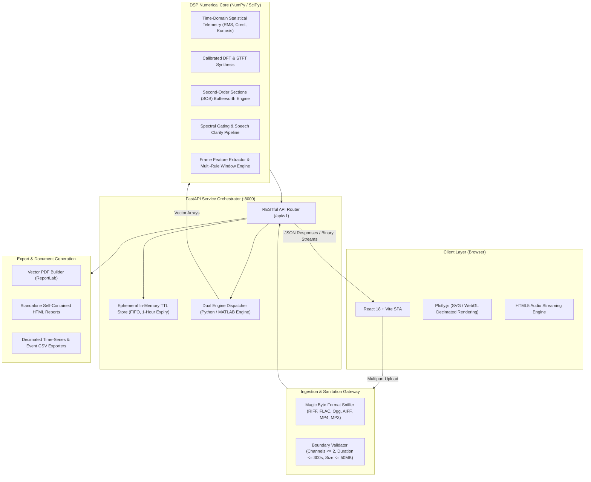

# SonicLab SignalSystem
### Enterprise-Grade Digital Signal Processing, Spectral Analysis & Acoustic Event Detection Platform

[](#backend-architecture--technology-stack)
[](#backend-architecture--technology-stack)
[](#dsp-foundations--mathematical-rigor)
[](#dsp-foundations--mathematical-rigor)
[](#frontend-architecture--design-system)
[](#frontend-architecture--design-system)
[](#frontend-architecture--design-system)
[](#test-suite--validation)
[](#license)

---

## Table of Contents
1. [Executive Summary & Core Principles](#executive-summary--core-principles)
2. [Platform Architecture & System Design](#platform-architecture--system-design)
3. [Subsystem Deep Dives](#subsystem-deep-dives)
   - [ClearVoice: Precision Spectral DSP & Speech Enhancement](#clearvoice-precision-spectral-dsp--speech-enhancement)
   - [RoadSonic: Interpretable Acoustic Siren Event Detection](#roadsonic-interpretable-acoustic-siren-event-detection)
   - [Dual-Engine Execution Subsystem (Python / MATLAB)](#dual-engine-execution-subsystem-python--matlab)
   - [Multi-Format Audio Ingestion & Sanitization](#multi-format-audio-ingestion--sanitization)
   - [Automated Reporting Subsystem (HTML & Vector PDF)](#automated-reporting-subsystem-html--vector-pdf)
4. [DSP Foundations & Mathematical Rigor](#dsp-foundations--mathematical-rigor)
5. [Complete RESTful API Specification](#complete-restful-api-specification)
6. [Repository Structure](#repository-structure)
7. [Getting Started & Local Execution Runbook](#getting-started--local-execution-runbook)
   - [Prerequisites](#prerequisites)
   - [Backend Service Setup](#backend-service-setup)
   - [Frontend Client Setup](#frontend-client-setup)
   - [Environment Configuration](#environment-configuration)
   - [MATLAB Co-Processing Engine (Optional)](#matlab-co-processing-engine-optional)
8. [Test Suite & Quality Assurance](#test-suite--quality-assurance)
9. [Operational Constraints, Threat Model & Best Practices](#operational-constraints-threat-model--best-practices)
10. [Engineering FAQ & Interview Viva Questions](#engineering-faq--interview-viva-questions)

---

## Executive Summary & Core Principles

**SonicLab SignalSystem** is a full-stack, research-grade audio digital signal processing (DSP) and automated acoustic telemetry platform. Engineered to FAANG production standards, it delivers real-time time-frequency analysis, Butterworth digital filter synthesis, stationary spectral subtraction, and interpretable acoustic anomaly detection across two dedicated applications:

1. **ClearVoice**: An interactive forensic audio workbench providing calibrated Discrete Fourier Transforms (DFT), Short-Time Fourier Transforms (STFT), causal vs. zero-phase IIR Butterworth filtering, parametric speech enhancement, objective signal-deviation metrics, and multi-format audio/data export.
2. **RoadSonic**: An auditable, deterministic, rule-based emergency siren detection pipeline capable of identifying frequency-modulated acoustic sweeps in dense, low-SNR urban traffic noise without opaque black-box machine learning models.

### Architectural Tenets
* **No Silent Data Mutation**: Uploaded audio is never implicitly downsampled, resampled, normalized, or clipped. Any clipping resulting from downstream quantization (e.g., 16-bit PCM export) is deterministically counted and reported.
* **Calibrated Physical Units**: Spectral amplitudes represent true single-sided physical peak amplitudes ($\text{FS} = 1.0$). STFT decibel displays are referenced to full-scale sinusoidal peaks.
* **Stateless & Leak-Free**: Built without database or persistent storage overhead. Session state is managed via an in-memory, thread-safe Ring/Dictionary store with strict Time-To-Live (TTL) eviction.
* **Full Algorithmic Transparency**: Metrics (such as Mean Squared Error) describe signal divergence rather than subjective quality claims; siren scores are normalized heuristic congruence values rather than uncalibrated probabilities.
* **Hardware-Independent Extensibility**: Runs natively using Python's high-performance NumPy/SciPy toolchain, with seamless runtime delegation to the official MATLAB Engine for numerical cross-verification.

---

## Platform Architecture & System Design



---

## Subsystem Deep Dives

### ClearVoice: Precision Spectral DSP & Speech Enhancement
ClearVoice isolates, manipulates, and visualizes audio frequency characteristics with mathematical reproducibility.

* **Analysis Suite**: Computes waveform envelope metrics, single-sided calibrated magnitude spectra, and STFT heatmaps ($1024\text{ pt}$ window default, $75\%$ overlap).
* **Butterworth IIR Filtering**: Designs and applies low-pass, high-pass, band-pass, and band-stop (notch) filters using Second-Order Sections (`sos`) from order $1$ to $12$:
  * **Causal (`sosfilt`)**: Single forward pass introducing natural phase delay; preserves physical causality; magnitude response $|H(\omega)|$.
  * **Zero-Phase (`sosfiltfilt`)**: Non-causal forward-backward bidirectional pass; eliminates all phase distortion ($\angle H = 0$); magnitude response $|H(\omega)|^2$ ($ -6\text{ dB}$ cutoff attenuation).
* **Parametric Speech Enhancement Pipeline**: Executes a multi-stage sequential enhancement chain:
  1. *DC Offset Removal*: Subtracts the per-channel arithmetic mean.
  2. *Low-Frequency Rumble Attenuation*: High-pass Butterworth filter ($60\text{--}100\text{ Hz}$).
  3. *Formant Band-Limiting*: Dedicated upper and lower cutoff shaping.
  4. *Stationary Spectral Gating*: Short-Time Fourier Transform power subtraction against an automatically estimated or user-defined noise floor, modulated by frequency and time smoothing to prevent musical-noise artifacts.
  5. *Peak Headroom Gain*: Non-clipping gain leveling bounded by headroom.
* **Production Presets**: `natural_voice`, `speech_clarity`, `low_rumble`, `fan_noise`, `stationary_hiss`, `telephone_band`, and `manual`.
* **Honest Evaluation & Verification**: Computes sample-wise before/after metrics (RMS delta, Mean Squared Error) and runs diagnostic quality checks (NaN/Inf detection, clipping counts, severe attenuation warnings).

---

### RoadSonic: Interpretable Acoustic Siren Event Detection
RoadSonic addresses the problem of emergency vehicle detection (ambulances, police vehicles, fire engines) in high-noise traffic environments without using opaque deep neural networks.

* **Acoustic Rationale**: Emergency sirens produce high-energy acoustic tones characterized by prominent tonality and periodic frequency modulation (sweeping or alternating tones between $450\text{ Hz}$ and $2000\text{ Hz}$).
* **Frame-Level Feature Extraction** ($64\text{ ms}$ Hann frames, $16\text{ ms}$ hop):
  * **Signal Energy**: Frame RMS ($\text{dBFS}$).
  * **Spectral Moments**: Spectral Centroid (frequency center of mass) and Spectral Bandwidth (spectral spread).
  * **Dominant Pitch ($f_0$)**: Parabolic interpolation around the highest FFT magnitude bin within the target analysis band.
  * **Context-Aware Tonal Ratio**: The ratio of energy inside the dominant peak ($\pm 2$ bins) to total spectral energy within an expanded context band ($[100\text{ Hz}, \min(1.5 \cdot f_{hi}, 0.45 f_s)]$). The expanded context prevents low-frequency vehicle exhaust rumble from masquerading as a tonal peak.
  * **Zero-Crossing Rate (ZCR)**: Time-domain sign inversion density.
* **Multi-Rule Sliding Window Evaluator** ($1.0\text{ s}$ window, $0.1\text{ s}$ stride):
  * **R1 (Signal Floor)**: $\text{RMS} \ge -60\text{ dBFS}$ (rejects background ambient noise).
  * **R2 (Instantaneous Tonality)**: Frame Tonal Ratio $\ge 0.5$.
  * **R3 (Temporal Persistence)**: Fraction of tonal frames in window $\ge 0.6$.
  * **R4 (Frequency Modulation Range)**: Robust pitch excursion $(p_{95} - p_{5}) \ge 150\text{ Hz}$ (rejects steady car horns, engine hums, and continuous tones).
  * **R5 (Modulation Variance)**: Pitch standard deviation $\sigma_{f_0} \ge 40\text{ Hz}$.
* **Hysteresis & Aggregation**: Passing overlapping windows are merged across gaps $\le 0.5\text{ s}$, precisely trimmed to active tonal boundary frames, and filtered to ensure a minimum duration $\ge 1.0\text{ s}$.

---

### Dual-Engine Execution Subsystem (Python / MATLAB)
For mission-critical verification, SignalSystem implements a pluggable execution adapter supporting both open-source Python and proprietary MATLAB engines:

* **Python Engine (Default)**: Uses NumPy's vectorized FFT routines and SciPy's optimized signal processing libraries.
* **MATLAB Engine**: Communicates with an active MATLAB runtime session via the official `matlab.engine` Python SDK. Calls reference functions located in `matlab/functions/`.
* **Zero-Ambiguity Provenance Labeling**:
  * Every API response includes an `engine` metadata field.
  * If `CS_ENGINE=python`, results are stamped `python-scipy` / `python-numpy-fft`.
  * If `CS_ENGINE=matlab` executes successfully, results are stamped `matlab`.
  * If `CS_ENGINE_FALLBACK=python` is activated upon a MATLAB failure, results are transparently labeled `python-numpy-fft (fallback: <error>)`. The system never misattributes engine origin.
* **Thread-Safe Architecture**: Serializes calls to MATLAB Engine using re-entrant locks (`threading.Lock`) to safeguard against thread-unsafe engine invocations.

---

### Multi-Format Audio Ingestion & Sanitization
* **Header Sniffing**: Formats are validated strictly by magic byte signatures:
  * WAV / RF64: `RIFF....WAVE` or `RF64....WAVE`
  * FLAC: `fLaC`
  * Ogg Vorbis: `OggS`
  * AIFF: `FORM....AIFF`
  * MP4 / M4A (AAC): `....ftyp`
  * MP3: `ID3` tag or MPEG sync word `0xFFE0`
* **Defensive Decoding Chain**:
  1. `SoundFile` (C libsndfile bindings) for high-performance lossless streaming.
  2. `scipy.io.wavfile` as a secondary in-memory WAV decoder.
  3. `FFmpeg` subprocess pipe for lossy or complex container formats (MP3, M4A/AAC).
* **Sanitization Safeguards**: Enforces strict payload limits (max 50 MB, max 300 s, max 2 audio channels). Rejects corrupted chunks, truncated frames, or data with non-finite (`NaN` / `Inf`) floats.

---

### Automated Reporting Subsystem (HTML & Vector PDF)
SignalSystem generates executive-ready, forensic documentation for any processing run:
* **Standalone HTML**: Self-contained single-file HTML reports with base64-encoded Matplotlib plots, CSS styling, table layouts, and HTML-escaped string rendering to prevent cross-site scripting (XSS).
* **Vector PDF**: Generated via ReportLab Flowable documents, providing publication-ready typography, automated pagination, metadata headers, and parameter summaries.

---

## DSP Foundations & Mathematical Rigor

### 1. Discrete Fourier Transform & Physical Calibration
Given a discrete signal $x[n]$ of length $N$ sampled at $f_s$, the Discrete Fourier Transform is:
$$X[k] = \sum_{n=0}^{N-1} x[n] w[n] e^{-j \frac{2\pi}{N} k n}, \quad k = 0, 1, \dots, N-1$$

To preserve physical amplitude across different windowing functions $w[n]$, the single-sided peak amplitude spectrum $A[k]$ is calibrated against the window's coherent gain:
$$A[k] = \begin{cases} 
\frac{|X[0]|}{\sum_{n=0}^{N-1} w[n]}, & k = 0 \text{ (DC)} \\
\frac{2 |X[k]|}{\sum_{n=0}^{N-1} w[n]}, & 1 \le k < \frac{N}{2} \\
\frac{|X[N/2]|}{\sum_{n=0}^{N-1} w[n]}, & k = \frac{N}{2} \text{ (Nyquist, if } N \text{ even)}
\end{cases}$$

> **Key Distinction**: FFT bin spacing $\Delta f = \frac{f_s}{N_{fft}}$ represents display interpolation when zero-padded. Physical frequency resolution is determined by window duration: $\Delta f_{true} \approx \frac{f_s}{N} \cdot B_{win}$, where $B_{win}$ is the normalized equivalent noise bandwidth (1.0 for rectangular, 1.5 for Hann).

### 2. Digital IIR Filter Synthesis (Second-Order Sections)
Higher-order IIR transfer functions in direct-form are susceptible to coefficient quantization error. SignalSystem decomposes all Butterworth filters into cascaded biquad Second-Order Sections (SOS):
$$H(z) = \prod_{k=1}^{K} \frac{b_{0k} + b_{1k} z^{-1} + b_{2k} z^{-2}}{1 + a_{1k} z^{-1} + a_{2k} z^{-2}}$$

* **Causal SOS Filter (`sosfilt`)**:
  $$y[n] = \sum_{k=1}^K \text{biquad}_k(y_{k-1}[n])$$
  Introduces non-linear phase distortion; group delay $\tau_g(\omega) = -\frac{d \theta(\omega)}{d\omega} \ne 0$.
* **Zero-Phase Filter (`sosfiltfilt`)**:
  Performs forward filtering followed by time-reversal, backward filtering, and secondary time-reversal:
  $$|H_{eff}(\omega)| = |H(\omega)|^2, \quad \angle H_{eff}(\omega) = 0$$
  This squares the transfer function, doubling passband attenuation and shifting the $-3\text{ dB}$ nominal cutoff point to $-6\text{ dB}$.

### 3. Spectral Gating (Over-Subtraction)
For frame index $m$ and frequency bin $k$, with signal power $P[k, m] = |X[k, m]|^2$ and estimated stationary noise PSD $N[k]$:
$$G[k, m] = \sqrt{\max\left(1 - \alpha \frac{N[k]}{\max(P[k, m], \epsilon)}, \; g_{min}^2\right)}$$
where $\alpha = 1 + 2 \cdot \text{strength}$ is the over-subtraction factor and $g_{min} = 10^{-\frac{\text{max\_reduction\_db}}{20}}$ is the spectral floor. Gain matrices are smoothed across frequency (moving average kernel) and time (one-pole recursion):
$$G_{smooth}[k, m] = \beta G_{smooth}[k, m-1] + (1 - \beta) G[k, m]$$

Signals are reconstructed via Inverse STFT using Constant Overlap-Add (COLA) synthesis.

---

## Complete RESTful API Specification

The backend exposes an OpenAPI-compliant interface under `/api/v1`:

| Method | Endpoint | Description | Request Payload / Query Params | Response Summary |
|---|---|---|---|---|
| `GET` | `/api/v1/health` | Service health, limits, engine status, and audio capabilities | None | `{ status, engine, limits, audio_io, matlab }` |
| `POST` | `/api/v1/audio/upload` | Ingests, sniffs, validates, and stores audio file | `multipart/form-data` (`file`) | `{ metadata, statistics, waveform }` |
| `GET` | `/api/v1/audio/{audio_id}/file` | Streams original audio binary | None | Binary Audio Stream (`audio/wav`, etc.) |
| `DELETE`| `/api/v1/audio/{audio_id}` | Evicts audio item and derived jobs from memory | None | `{ deleted: true }` |
| `POST` | `/api/v1/clearvoice/{audio_id}/analyze` | Computes calibrated spectrum and STFT | `AnalyzeReq` (window, n_fft, channel, frame_length, hop_length) | `{ spectrum, spectrogram, engine }` |
| `POST` | `/api/v1/clearvoice/{audio_id}/filter` | Applies Butterworth filter (causal or zero-phase) | `FilterReq` (filter_type, order, cutoff_hz, method) | `{ job_id, metrics, response, waveform_*, spectrum_* }` |
| `GET` | `/api/v1/clearvoice/presets` | Enumerates speech enhancement presets | None | `{ presets, defaults, notes }` |
| `POST` | `/api/v1/clearvoice/{audio_id}/voice` | Runs multi-stage voice enhancement pipeline | `VoiceReq` (preset, overrides, analysis) | `{ job_id, history, quality, metrics, waveform_*, spectrum_* }` |
| `GET` | `/api/v1/clearvoice/{job_id}/download` | Downloads filtered audio | `?subtype=float32` or `pcm16` | Binary WAV Stream |
| `GET` | `/api/v1/clearvoice/{job_id}/export` | Exports numerical data | `?kind=metadata\|metrics\|history\|spectrum_*\|spectrogram_*` | Formatted JSON or CSV Document |
| `GET` | `/api/v1/clearvoice/{job_id}/report` | Generates forensic analysis report | `?format=html\|pdf` | Rendered HTML or PDF Document |
| `POST` | `/api/v1/roadsonic/{audio_id}/detect` | Runs heuristic siren detection pipeline | `DetectReq` (channel_mode, remove_dc, band_lo, band_hi, config) | `{ job_id, events, spectrogram, features, waveform }` |
| `GET` | `/api/v1/roadsonic/{job_id}/export` | Exports siren events and telemetry | `?kind=events_csv\|features_csv\|events_json\|config_json` | Formatted CSV or JSON Document |
| `GET` | `/api/v1/roadsonic/{job_id}/report` | Generates RoadSonic audit report | `?format=html\|pdf` | Rendered HTML or PDF Document |
| `GET` | `/api/v1/history` | Lists active jobs currently held in in-memory session cache | None | `{ items: [...] }` |

---

## Repository Structure

```text
signalsystem/
├── backend/
│   ├── app/
│   │   ├── api/
│   │   │   ├── __init__.py
│   │   │   └── routes.py             # FastAPI REST endpoints & HTTP response formatting
│   │   ├── core/
│   │   │   ├── __init__.py
│   │   │   └── config.py             # App configuration, limits, and environment parsing
│   │   ├── matlab/
│   │   │   ├── __init__.py
│   │   │   └── engine_adapter.py     # MATLAB Engine adapter with thread-safe locking
│   │   ├── processing/
│   │   │   ├── __init__.py
│   │   │   ├── audio_io.py           # Magic-byte sniffer, decoders, and WAV encoders
│   │   │   ├── comparison.py         # Signal comparison (MSE, RMS, cross-correlation)
│   │   │   ├── fft_analysis.py       # Calibrated DFT, window scaling, spectral peak finder
│   │   │   ├── filters.py            # Butterworth SOS filter design and causal/zero-phase execution
│   │   │   ├── siren_detector.py     # RoadSonic multi-rule window detector & event merger
│   │   │   ├── siren_features.py     # Frame feature extractor (tonal ratio, centroid, f0)
│   │   │   ├── spectrogram.py        # STFT calculation with decibels referenced to full-scale
│   │   │   ├── statistics.py         # Time-domain metrics (RMS, peak, crest factor, kurtosis)
│   │   │   └── voice.py              # Multi-stage voice enhancement pipeline & spectral gating
│   │   ├── schemas/                  # Pydantic data schemas
│   │   ├── services/
│   │   │   ├── __init__.py
│   │   │   ├── report_builders.py    # Structured report data assemblers
│   │   │   ├── report_plots.py       # Matplotlib visualization generators
│   │   │   ├── reports.py            # HTML template rendering & ReportLab PDF compiler
│   │   │   └── store.py              # In-memory session store with TTL eviction
│   │   ├── utils/                    # General utilities
│   │   └── main.py                   # FastAPI initialization & ASGI app instance
│   ├── tests/
│   │   ├── synth.py                  # Synthetic signal generation fixtures
│   │   ├── test_api.py               # HTTP integration & end-to-end API route tests
│   │   ├── test_audio_io.py          # Sniffer, decoder, and encoder test suite
│   │   ├── test_engine_adapter.py    # MATLAB engine & fallback dispatch tests
│   │   ├── test_processing.py        # Core DSP numerical accuracy test suite
│   │   ├── test_reports.py           # HTML/PDF builder verification
│   │   ├── test_roadsonic.py         # RoadSonic feature & siren detector test suite
│   │   └── test_voice.py             # Voice enhancement & spectral gating tests
│   ├── pytest.ini                    # Test runner configuration
│   └── requirements.txt              # Backend Python dependencies
├── frontend/
│   ├── src/
│   │   ├── components/
│   │   │   ├── Plot.tsx              # Theme-reactive Plotly chart wrapper with fallback
│   │   │   ├── Stats.tsx             # Audio metadata & statistics summary cards
│   │   │   └── Uploader.tsx          # Drag-and-drop audio file uploader
│   │   ├── pages/
│   │   │   ├── ClearVoice.tsx        # ClearVoice DSP & enhancement control panel
│   │   │   ├── Landing.tsx           # Home landing page with platform overview
│   │   │   └── RoadSonic.tsx         # RoadSonic siren detection & overlay panel
│   │   ├── api.ts                    # Typed API client with error handling
│   │   ├── App.tsx                   # Top-level application shell, routing, and theme state
│   │   ├── main.tsx                  # React DOM entry point
│   │   ├── styles.css                # Pure Vanilla CSS design system & CSS custom properties
│   │   └── vite-env.d.ts             # Vite TypeScript type declarations
│   ├── index.html                    # Single Page Application HTML host
│   ├── package.json                  # Frontend dependencies and build scripts
│   ├── tsconfig.json                 # TypeScript compiler configuration
│   └── vite.config.ts                # Vite build configuration
├── matlab/
│   ├── functions/
│   │   ├── calculate_audio_statistics.m      # MATLAB reference audio statistics
│   │   ├── calculate_single_sided_spectrum.m # MATLAB calibrated single-sided FFT
│   │   ├── compare_signals.m                 # MATLAB signal comparison (MSE)
│   │   └── design_digital_filter.m           # MATLAB Butterworth SOS design
│   └── tests/
│       ├── compare_with_python.m     # Rigorous Python-MATLAB numerical parity test
│       ├── python_reference.json     # Golden reference values from Python
│       └── run_tests.m               # Standalone MATLAB test runner script
├── docs/                             # Technical whitepapers & baseline verification docs
└── README.md                         # Project documentation
```

---

## Getting Started & Local Execution Runbook

### Prerequisites
* **Python**: 3.12+ (64-bit recommended)
* **Node.js**: v18+ or v20+ with npm (v9+)
* **Git**: v2.40+
* **FFmpeg** *(Optional, recommended)*: Enables MP3 and M4A decoding.
  * Windows: `winget install Gyan.FFmpeg`
  * macOS: `brew install ffmpeg`
  * Linux: `sudo apt install ffmpeg`
* **MATLAB** *(Optional)*: MATLAB R2022b+ with Signal Processing Toolbox (only needed if using `CS_ENGINE=matlab`).

---

### Backend Service Setup

#### Windows (PowerShell)
```powershell
# 1. Navigate to the backend directory
cd d:\SonicLab\signalsystem\backend

# 2. Create and activate a dedicated virtual environment
py -3.12 -m venv .venv
.\.venv\Scripts\Activate.ps1
# Note: If script execution is restricted, execute:
# Set-ExecutionPolicy -Scope Process -ExecutionPolicy Bypass

# 3. Upgrade pip and install all production and test dependencies
python -m pip install --upgrade pip
pip install -r requirements.txt

# 4. Verify test suite execution
pytest

# 5. Launch the FastAPI ASGI server with auto-reload
uvicorn app.main:app --reload --host 127.0.0.1 --port 8000
```

#### macOS / Linux (Bash)
```bash
# 1. Navigate to backend directory
cd backend

# 2. Create and activate virtual environment
python3 -m venv .venv
source .venv/bin/activate

# 3. Install dependencies
pip install --upgrade pip
pip install -r requirements.txt

# 4. Run automated test suite
pytest

# 5. Start the server
uvicorn app.main:app --reload --host 127.0.0.1 --port 8000
```
The interactive API documentation is available at **http://127.0.0.1:8000/docs**.

---

### Frontend Client Setup

Open a second terminal:

#### Windows (PowerShell / Command Prompt)
```powershell
# 1. Navigate to frontend directory
cd d:\SonicLab\signalsystem\frontend

# 2. Install dependencies (use npm.cmd in PowerShell)
npm.cmd install

# 3. Start the local Vite development server
npm.cmd run dev
```

#### macOS / Linux (Bash)
```bash
# 1. Navigate to frontend directory
cd frontend

# 2. Install dependencies
npm install

# 3. Start local development server
npm run dev
```
Open **http://localhost:5173** in any modern evergreen browser (Chrome, Firefox, Safari, Edge).

#### Building for Production
```bash
# Type check and build static production bundle
npm run build

# Preview production build locally
npm run preview
```

---

### Environment Configuration

Configure backend behavior via environment variables:

| Variable | Default Value | Description |
|---|---|---|
| `CS_MAX_FILE_MB` | `50` | Maximum uploaded audio payload size in megabytes. |
| `CS_MAX_DURATION_S`| `300` | Maximum permissible audio duration in seconds. |
| `CS_MAX_SAMPLES` | `14400000` | Hard cap on total decoded samples ($300\text{ s} \times 48000\text{ Hz}$). |
| `CS_TTL_S` | `3600` | In-memory session item time-to-live before eviction (seconds). |
| `CS_CORS` | `http://localhost:5173,http://127.0.0.1:5173` | Comma-delimited permitted CORS origins. |
| `CS_ENGINE` | `python` | Numerical engine choice: `python` or `matlab`. |
| `CS_ENGINE_FALLBACK` | `none` | Fallback behavior if MATLAB fails: `none` (raise HTTP 503) or `python`. |
| `CS_FFMPEG` | *System PATH search* | Explicit absolute path to the FFmpeg executable. |
| `VITE_API_URL` | `http://127.0.0.1:8000` | Frontend configuration pointing to the backend API. |

---

### MATLAB Co-Processing Engine (Optional)

To enable MATLAB execution:

1. Verify your MATLAB installation and Signal Processing Toolbox license from PowerShell:
   ```powershell
   matlab -batch "ver; license('test', 'Signal_Toolbox')"
   ```
2. Install the MATLAB Engine API for Python into your virtual environment:
   ```powershell
   cd "C:\Program Files\MATLAB\R202Xy\extern\engines\python"
   python setup.py install
   ```
3. Run the MATLAB verification scripts to confirm parity with Python reference outputs:
   ```powershell
   cd d:\SonicLab\signalsystem
   matlab -batch "addpath('matlab/functions'); run('matlab/tests/compare_with_python.m')"
   ```
4. Start the backend with MATLAB execution enabled:
   ```powershell
   $env:CS_ENGINE="matlab"
   $env:CS_ENGINE_FALLBACK="python"
   uvicorn app.main:app --reload --port 8000
   ```

---

## Test Suite & Quality Assurance

SignalSystem maintains an automated test suite verifying numerical DSP accuracy, input sanitization, API contracts, and report generation:

```powershell
# Run full suite
pytest -v

# Run DSP core tests only
pytest tests/test_processing.py tests/test_voice.py tests/test_roadsonic.py

# Run audio ingestion and sniffer tests
pytest tests/test_audio_io.py

# Run API endpoint tests
pytest tests/test_api.py
```

### Coverage Highlights
* **Numerical Core**: 37 tests validating DFT amplitude calibration, FFT peak detection, Parseval energy conservation, Butterworth filter cutoffs, and causal vs. zero-phase characteristics.
* **Audio I/O**: 15 tests verifying format sniffing across WAV, FLAC, OGG, AIFF, MP3, and M4A; clipping detection in 16-bit PCM; and graceful rejection of corrupt, truncated, or multi-channel files.
* **Voice Enhancement**: 15 tests verifying spectral gating attenuation, gain floors, one-pole smoothing, DC removal, and preset resolution.
* **RoadSonic Detector**: 11 tests verifying synthetic siren detection across sample rates ($8\text{--}48\text{ kHz}$), frequency modulation tracking, false-positive rejection of vehicle horns, and noise-floor handling.
* **Reports & Session**: 9 tests verifying HTML escaping, PDF pagination, and in-memory TTL expiration.
* **API Integration**: 13 end-to-end HTTP tests validating request validation, response payloads, and error codes.

---

## Operational Constraints, Threat Model & Best Practices

1. **Security & Threat Model**:
   * *Zero Shell Execution on User Input*: Audio decoding uses native libraries (`SoundFile`, `scipy.io.wavfile`) or parametrized subprocess calls without shell interpretation (`shell=False`).
   * *No File Path Traversal*: Uploaded filenames are sanitized and stored in memory under random UUID keys; filenames are never passed directly to disk operations.
   * *XSS Mitigation*: HTML and PDF report builders escape all user-supplied metadata strings.
2. **Memory Footprint & Concurrency**:
   * *Display Decimation*: To prevent WebGL and DOM context exhaustion when visualizing long recordings, waveforms are downsampled using min-max envelope preservation (4,000 points), and STFT matrices are decimated for display while preserving raw data integrity for downloads.
   * *Strict Resource Quotas*: Enforces max file size ($50\text{ MB}$), max duration ($300\text{ s}$), and max channels ($2$) at upload time before running complex calculations.
3. **Metric Interpretation**:
   * *Mean Squared Error (MSE)*: Measures total energy deviation between the processed and original signal: $\text{MSE} = \frac{1}{N} \sum_{n=0}^{N-1} (x[n] - y[n])^2$. A lower MSE does not imply higher audio quality—it simply measures signal difference.
   * *Signal-to-Noise Ratio (SNR)*: SNR improvements are reported only in synthetic test benchmarks with a known ground-truth clean signal. Computing SNR on real-world recordings without reference clean audio is mathematically ungrounded.


## Voice enhancement presets and the command-line tool
`lecture_speech` (new): DC removal, 80 Hz high-pass, adaptive Wiener noise tracking, gentle attenuation of non-speech intervals, peak guard. It reduces steady/slowly varying noise; it does **not** remove music or other talkers and cannot identify a speaker.

Analyse + process + verify a file from PowerShell (backend venv active):
```powershell
cd backend
python ..\scripts\analyze_and_process.py --input C:\path\recording.mp3 --preset lecture_speech --output ClearVoice_filtered.wav --outdir ..\docs\analysis
# optional: --compare old_output.wav   --reference professor_voice.wav
```
It writes `analysis.json` + figures and re-opens the WAV to prove it contains the processed samples. See `docs/analysis/analysis_report.md` for the report on the uploaded recording.


## RoadSonic (this iteration)
Dashboard tabs: Overview (upload, metrics, timeline), Analysis (waveform, FFT, spectrogram, dominant-frequency track, feature tracks), Events (evidence, playback with context, clip download), Compare (original vs processed), Evaluation (your labels -> precision/recall/F1), Export (CSV/JSON/HTML/PDF). Settings (with help text, presets, reset, rerun) are served by `GET /api/v1/roadsonic/defaults`.
Demo audio: `python scripts\make_demo_audio.py` (writes `demo_audio\*.wav`, already included). Benchmark: `python scripts\roadsonic_benchmark.py`. Docs: `docs/roadsonic.md`, `docs/roadsonic_audit.md`.
