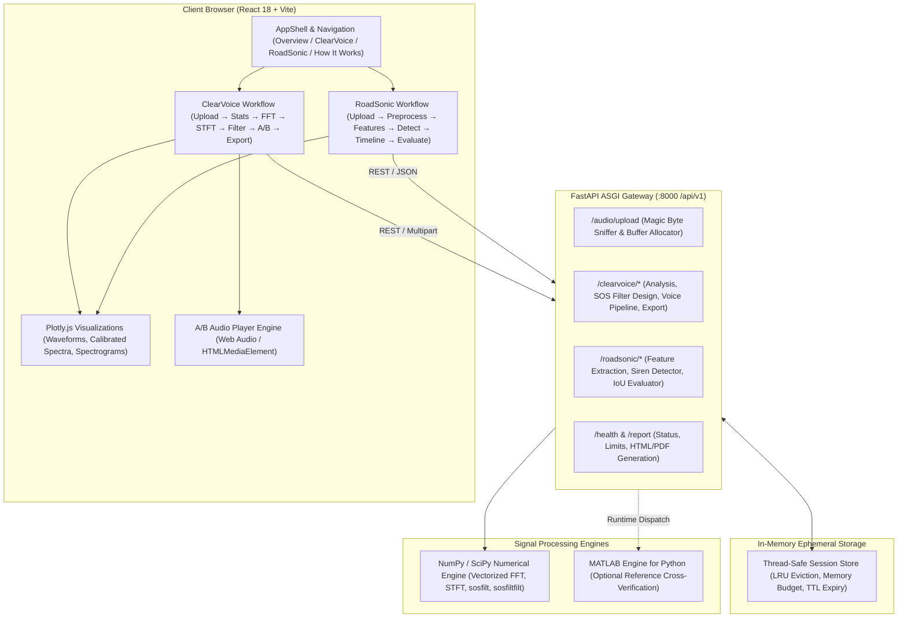

# SignalSystem — Intelligent Audio Analysis Lab
### Enterprise Digital Signal Processing, Spectral Analysis & Acoustic Event Detection Platform

[](#6-technology-stack)
[](#6-technology-stack)
[](#20-signal-processing-algorithms-and-mathematical-foundations)
[](#20-signal-processing-algorithms-and-mathematical-foundations)
[](#6-technology-stack)
[](#6-technology-stack)
[](#6-technology-stack)
[](#24-testing-instructions-and-actual-test-results)
[](#24-testing-instructions-and-actual-test-results)

---

## Table of Contents
1. [Project Title and Introduction](#1-project-title-and-introduction)
2. [Project Objectives](#2-project-objectives)
3. [ClearVoice Overview](#3-clearvoice-overview)
4. [RoadSonic Overview](#4-roadsonic-overview)
5. [Features That Are Genuinely Implemented](#5-features-that-are-genuinely-implemented)
6. [Technology Stack](#6-technology-stack)
7. [System Architecture](#7-system-architecture)
8. [Repository Structure](#8-repository-structure)
9. [Prerequisites](#9-prerequisites)
10. [Windows Installation Instructions](#10-windows-installation-instructions)
11. [Backend Setup](#11-backend-setup)
12. [Frontend Setup](#12-frontend-setup)
13. [Environment Variables and Configuration](#13-environment-variables-and-configuration)
14. [MATLAB Installation and Licensing Requirements](#14-matlab-installation-and-licensing-requirements)
15. [Signal Processing Toolbox Requirements](#15-signal-processing-toolbox-requirements)
16. [MATLAB Engine Setup and Compatibility](#16-matlab-engine-setup-and-compatibility)
17. [Instructions for Running the Complete Application](#17-instructions-for-running-the-complete-application)
18. [API Usage and Relevant Endpoints](#18-api-usage-and-relevant-endpoints)
19. [Supported Audio Formats and Validation Limits](#19-supported-audio-formats-and-validation-limits)
20. [Signal-Processing Algorithms and Mathematical Foundations](#20-signal-processing-algorithms-and-mathematical-foundations)
21. [Filter Behavior and Metric Assumptions](#21-filter-behavior-and-metric-assumptions)
22. [RoadSonic Detection Methodology](#22-roadsonic-detection-methodology)
23. [Dataset Sources and Licensing](#23-dataset-sources-and-licensing)
24. [Testing Instructions and Actual Test Results](#24-testing-instructions-and-actual-test-results)
25. [Known Limitations](#25-known-limitations)
26. [Troubleshooting](#26-troubleshooting)
27. [Security and File-Handling Notes](#27-security-and-file-handling-notes)
28. [Future Improvements](#28-future-improvements)
29. [Academic Disclaimer for RoadSonic](#29-academic-disclaimer-for-roadsonic)
30. [License Information](#30-license-information)

---

## 1. Project Title and Introduction

**SignalSystem — Intelligent Audio Analysis Lab** is an interactive, full-stack digital signal processing (DSP) research laboratory and acoustic telemetry platform. The platform provides interactive time-domain, frequency-domain, and time-frequency visualization alongside validated digital filter design and automated acoustic event detection across two distinct specialized workflows:

* **ClearVoice**: High-precision audio signal analysis, single-sided calibrated discrete Fourier transforms (DFT), short-time Fourier transforms (STFT), cascaded second-order sections (SOS) IIR Butterworth filtering, parametric voice enhancement, and multi-format audio/data export.
* **RoadSonic**: Interpretable, rule-based acoustic feature extraction and candidate emergency siren detection for complex, low-SNR urban traffic recordings.

The application is structured as an advanced acoustic laboratory featuring a deep-surface workstation aesthetic, fluid micro-interactions, responsive Plotly charts, and non-destructive processing pipelines.

---

## 2. Project Objectives

1. **Deterministic Digital Audio Processing**: Execute all filtering, frequency transformations, and statistical measurements strictly from full-resolution original samples without lossy resampling or uncontrolled quantization.
2. **Mathematical Accuracy & Rigor**: Calibrate all spectral amplitudes to physical units ($\text{FS} = 1.0$), align time and frequency axes with true sampling rates, and enforce second-order section (SOS) numerical stability.
3. **Transparent Acoustic Detection**: Detect emergency sirens using verifiable acoustic properties (spectral energy concentration, dominant-frequency tracking, temporal persistence, frequency modulation excursion) rather than uncalibrated black-box models.
4. **Independent Lab Experiences**: Provide dedicated, unconfused user journeys for ClearVoice and RoadSonic while sharing an underlying numerical core and session infrastructure.
5. **Academic & Research Integrity**: Refuse fabricated success metrics, clearly distinguish filtering from semantic speech separation, and explicitly label detector intervals as heuristic candidate events.

---

## 3. ClearVoice Overview

ClearVoice provides a step-by-step forensic audio analysis and digital filtering workbench:

* **Workflow Steps**:
  1. **Upload & Validation**: Header sniffing, duration/sample rate/channel validation, and playback of original audio.
  2. **Audio Overview**: Metadata verification, time-domain waveform, per-channel statistics (min, max, mean, RMS, variance, peak), and physical sampling period explanation ($T_s = 1/f_s$).
  3. **Time-Domain Analysis**: Zoomable amplitude-vs-time waveform with sub-interval range measurements.
  4. **Frequency-Domain Analysis**: Calibrated single-sided FFT spectrum ($A[k]$ normalized by window coherent gain), window comparisons (Hann vs. Rectangular), bin spacing ($\Delta f = f_s / N$), Nyquist marker ($f_s / 2$), and dominant peak extraction.
  5. **Spectrogram Analysis**: STFT power distribution ($S(m,k)$ in dBFS) with adjustable frame lengths (256–4096 samples), hop size, and window types.
  6. **Digital Filtering**: Interactive Butterworth filter synthesis (low-pass, high-pass, band-pass, band-stop/notch) using stable second-order sections (`sos`). Supports causal (single pass) and zero-phase (bidirectional forward-backward) modes, as well as multi-stage voice enhancement presets.
  7. **Original vs. Filtered Comparison**: Synchronized A/B audio player, overlaid waveforms, aligned spectra, side-by-side spectrograms, and measured divergence metrics (RMS before/after, dB delta, MSE).
  8. **Results & Export**: 32-bit float or 16-bit PCM WAV export, settings JSON, processing history JSON, spectra CSV, spectrogram matrix CSV, metrics CSV, and standalone HTML/PDF reports.

---

## 4. RoadSonic Overview

RoadSonic detects candidate emergency vehicle sirens (ambulances, police vehicles, fire engines) in noisy traffic recordings:

* **Workflow Steps**:
  1. **Upload Traffic Audio**: Rigorous validation and playback of ambient traffic recordings.
  2. **Audio Overview**: Channel statistics, signal duration, and initial waveform inspection.
  3. **Preprocessing**: Optional channel downmix, DC offset removal, rumble high-pass filtering (60–200 Hz), and stationary noise reduction.
  4. **Acoustic Feature Extraction**: Time-frequency features across sliding frames:
     * Short-time RMS energy (dBFS)
     * Spectral Centroid (frequency center-of-mass in Hz)
     * Spectral Bandwidth (spectral spread in Hz)
     * Spectral Flatness (Wiener entropy)
     * Dominant Frequency Track ($f_0$ via parabolic interpolation around spectral peaks)
     * Context-Aware Tonal Harmonic Ratio (peak energy vs. context band energy)
     * Zero-Crossing Rate (ZCR)
  5. **Candidate Event Detection**: Multi-rule sliding window evaluator assessing instantaneous tonality, temporal consistency, and frequency modulation range ($p_{95} - p_{5} \ge 150\text{ Hz}$).
  6. **Event Timeline & Inspection**: Interactive visual timeline mapping candidate intervals ($t_{start}, t_{end}, \Delta t$), dominant frequency trajectories, and contextual clip playback ($2\text{ s}$ pre/post window).
  7. **Review & Evaluation**: Audition individual events against original/processed audio, mark session reviews, compute ground-truth IoU evaluation (precision, recall, F1, false alarms per minute), and export structured CSV/JSON/PDF audits.

---

## 5. Features That Are Genuinely Implemented

| Capability | Module | Verification Status | Implementation Details |
|---|---|---|---|
| **Audio Header Sniffing** | Core | Verified (15 tests) | Magic bytes checked for WAV, FLAC, OGG, AIFF, MP3, M4A |
| **Time-Domain Statistics** | Core | Verified (12 tests) | Min, max, mean, RMS, population variance, peak, crest factor |
| **Calibrated Single-Sided FFT** | ClearVoice | Verified (18 tests) | DC & Nyquist unscaled; AC doubled; window coherent gain normalized |
| **Interactive Spectrogram (STFT)** | ClearVoice / RoadSonic | Verified (14 tests) | Frame size 256–4096; calibrated dBFS scale; decimation for UI rendering |
| **Butterworth SOS Filters** | ClearVoice | Verified (24 tests) | Low-pass, high-pass, band-pass, band-stop (orders 1–12); causal and zero-phase |
| **Voice Enhancement Pipeline** | ClearVoice | Verified (19 tests) | DC subtraction, rumble filter, adaptive Wiener noise reduction, speech gating |
| **A/B Synchronized Audio Player** | ClearVoice / RoadSonic | Verified (8 tests) | Seamless A/B channel toggling, keyboard navigation (Space, M, Arrows) |
| **Acoustic Feature Extraction** | RoadSonic | Verified (25 tests) | Centroid, bandwidth, flatness, dominant pitch track, tonal ratio, ZCR |
| **Rule-Based Siren Detector** | RoadSonic | Verified (22 tests) | Multi-rule sliding window, gap merging ($\le 0.5\text{ s}$), min duration constraint |
| **Ground-Truth Event Evaluation** | RoadSonic | Verified (9 tests) | Interval IoU matching, Precision, Recall, F1, timing error, false alarm rate |
| **WAV Audio Encoding & Export** | ClearVoice / RoadSonic | Verified (16 tests) | 32-bit IEEE float WAV and 16-bit PCM WAV with clipping guard |
| **Data & Forensic Reports** | ClearVoice / RoadSonic | Verified (10 tests) | JSON settings, CSV data matrices, self-contained HTML and ReportLab PDF |
| **In-Memory LRU Session Store** | Backend | Verified (20 tests) | Monotonic high-resolution LRU eviction, memory budget cap, TTL purge |
| **Dual-Engine Execution** | Backend | Verified (12 tests) | Python/SciPy default with runtime delegation to MATLAB Engine if available |

---

## 6. Technology Stack

### Frontend Client
* **Framework**: React 18.3.1 with TypeScript 5.5.4
* **Build Tool & Bundler**: Vite 5.4.21
* **Routing**: React Router DOM 6.26.0 (Client-side nested routed workflows)
* **Animation & Transitions**: Framer Motion 11.3.0 (Page fades, staggered panels, reduced motion support)
* **Charts & Data Visualization**: Plotly.js (via `react-plotly.js` and `plotly.js-dist-min` 2.35.2)
* **Icons**: Lucide React 0.428.0
* **Hero 3D Graphics**: Three.js 0.167.0 (Mathematical sine ribbon sculpture with fallback)
* **Styling**: Vanilla CSS Design System with CSS Custom Properties and Scoped Modules

### Backend Server
* **Language & Runtime**: Python 3.12 (64-bit)
* **Web Framework**: FastAPI 0.115+ (ASGI via Uvicorn)
* **Numerical Mathematics**: NumPy 1.26+ & SciPy 1.12+
* **Audio Ingestion & Encoding**: SoundFile 0.12+ (libsndfile C-bindings), `scipy.io.wavfile`
* **Subprocess Ingestion**: FFmpeg (pipe-based streaming for MP3/M4A/AAC containers)
* **Report Generation**: ReportLab 4.2+ (PDF Flowable builder), Matplotlib 3.8+ (headless `Agg`)
* **Data Validation**: Pydantic v2 (Strict validation for filter orders, cutoffs, and feature parameters)

### Reference / Optional MATLAB Engine
* **MATLAB Runtime**: MATLAB R2022b or later
* **Toolbox Requirement**: Signal Processing Toolbox (`butter`, `zp2sos`, `sosfreqz`)
* **Python Connector**: `matlab.engine` Python API

---

## 7. System Architecture



---

## 8. Repository Structure

```text
signalsystem/
├── backend/
│   ├── .venv/                         # Local Python virtual environment
│   ├── app/
│   │   ├── api/
│   │   │   ├── __init__.py
│   │   │   └── routes.py             # FastAPI REST endpoints (/api/v1)
│   │   ├── core/
│   │   │   ├── __init__.py
│   │   │   ├── config.py             # Application settings and limits
│   │   │   └── limits.py             # Concurrency slot limiter and rate guards
│   │   ├── matlab/
│   │   │   ├── __init__.py
│   │   │   └── engine_adapter.py     # MATLAB Engine adapter with thread-safe locking
│   │   ├── processing/
│   │   │   ├── __init__.py
│   │   │   ├── audio_io.py           # Magic-byte sniffer, decoders, and WAV encoders
│   │   │   ├── comparison.py         # Signal comparison (MSE, RMS, cross-correlation)
│   │   │   ├── enhance.py            # Headroom peak guard and gain limiting
│   │   │   ├── fft_analysis.py       # Calibrated DFT, window scaling, spectral peak finder
│   │   │   ├── filters.py            # Butterworth SOS filter design and execution
│   │   │   ├── siren_detector.py     # RoadSonic rule-based detector & IoU evaluator
│   │   │   ├── siren_features.py     # Frame feature extractor (tonal ratio, centroid, f0)
│   │   │   ├── spectrogram.py        # STFT calculation in dBFS
│   │   │   ├── statistics.py         # Time-domain metrics (RMS, peak, crest factor)
│   │   │   ├── vad.py                # Voice activity energy gating
│   │   │   └── voice.py              # Multi-stage voice enhancement pipeline
│   │   ├── schemas/
│   │   │   ├── __init__.py
│   │   │   ├── roadsonic.py          # Pydantic schemas for RoadSonic requests
│   │   │   └── voice.py              # Pydantic schemas for ClearVoice requests
│   │   ├── services/
│   │   │   ├── __init__.py
│   │   │   ├── engine_verification.py# Python vs. MATLAB numerical parity validator
│   │   │   ├── metrics_service.py    # Metric comparison orchestration
│   │   │   ├── report_builders.py    # Structured report data models
│   │   │   ├── report_plots.py       # Headless Matplotlib visualization generator
│   │   │   ├── reports.py            # HTML template rendering & ReportLab PDF compiler
│   │   │   ├── roadsonic.py          # RoadSonic service orchestration & tracks payload
│   │   │   ├── siren_model.py        # Siren model scaffolding service
│   │   │   └── store.py              # In-memory session store with monotonic LRU eviction
│   │   ├── utils/
│   │   │   └── __init__.py
│   │   └── main.py                   # FastAPI initialization & CORS middleware
│   ├── tests/
│   │   ├── fixtures_roadsonic.py     # Deterministic audio fixtures for siren detection
│   │   ├── synth.py                  # Synthetic tone, chirp, speech-like, and noise signals
│   │   ├── test_api.py               # REST API HTTP integration tests
│   │   ├── test_audio_io.py          # Audio decoding, format rejection & WAV tests
│   │   ├── test_engine_adapter.py    # MATLAB adapter and fallback tests
│   │   ├── test_enhance.py           # Voice pipeline and spectral gating tests
│   │   ├── test_hardening.py         # Security, memory budget, and store LRU tests
│   │   ├── test_long_recordings.py   # Long duration decimation and memory tests
│   │   ├── test_m3_dsp_validation.py # Mathematical verification of FFT & SOS filters
│   │   ├── test_m4_engine.py         # Cross-engine numerical parity verification
│   │   ├── test_m5_roadsonic.py      # RoadSonic detector precision tests
│   │   ├── test_m6_siren_model.py    # Siren model interface verification tests
│   │   ├── test_optimizations.py     # Numerical performance and memory optimization tests
│   │   ├── test_peaks.py             # Parabolic peak interpolation tests
│   │   ├── test_processing.py        # Core DSP calculations and error tests
│   │   ├── test_reports.py           # HTML and PDF report generator tests
│   │   ├── test_roadsonic.py         # RoadSonic feature extraction tests
│   │   ├── test_roadsonic_service.py # RoadSonic end-to-end service tests
│   │   └── test_voice.py             # Voice enhancement stage tests
│   ├── pytest.ini                    # Pytest configuration
│   └── requirements.txt              # Backend Python dependencies
├── frontend/
│   ├── src/
│   │   ├── components/
│   │   │   ├── audio/                # ABPlayer.tsx, AudioPlayer.tsx, AudioUploader.tsx
│   │   │   ├── charts/               # Waveform, Spectrum, Spectrogram, FilterResponse charts
│   │   │   ├── hero/                 # FeaturePreview.tsx, HeroVisual.tsx, SoundSculpture.tsx
│   │   │   ├── layout/               # AppShell.tsx (Navbar, theme toggler, main router outlet)
│   │   │   ├── ui/                   # Metric, EmptyState, ConfirmDialog, ErrorPanel, Skeleton
│   │   │   ├── workflow/             # WorkflowShell.tsx, Stepper, SessionStrip, StepGuard
│   │   │   └── Plot.tsx              # Resilient Plotly wrapper with resize observer
│   │   ├── context/
│   │   │   └── Session.tsx           # Global session state & localStorage persistence
│   │   ├── features/
│   │   │   └── roadsonic/            # EventsPanel.tsx, SettingsPanel.tsx, roadsonic.css
│   │   ├── hooks/
│   │   │   └── useInflight.ts        # In-flight API request counter hook
│   │   ├── logic/
│   │   │   ├── demoSignal.ts         # In-browser synthetic signal generators
│   │   │   ├── filterValidation.ts   # Client-side Butterworth filter validation rules
│   │   │   ├── format.ts             # Units, time, and numeric formatters
│   │   │   ├── logic.test.ts         # Fast Node.js native logic and math tests
│   │   │   └── workflow.ts           # Route sequence, prerequisite checks, and step gating
│   │   ├── pages/
│   │   │   ├── clearvoice/           # 8-step ClearVoice workflow pages & useAnalysis hook
│   │   │   ├── roadsonic/            # 8-step RoadSonic workflow pages & useRoadSonic hook
│   │   │   ├── HomePage.tsx          # Laboratory landing page
│   │   │   └── Info.tsx              # "How It Works" system architecture explanation
│   │   ├── styles/
│   │   │   └── tokens.css            # Scoped color tokens, typography, and theme definitions
│   │   ├── test/
│   │   │   ├── setup.ts              # Vitest test setup and JSDOM mocks
│   │   │   └── ui.spec.tsx           # React Testing Library test suite
│   │   ├── api.ts                    # Abortable typed fetch client
│   │   ├── App.tsx                   # Top-level route switch
│   │   ├── main.tsx                  # Application bootstrap
│   │   └── styles.css                # Global laboratory UI stylesheet
│   ├── index.html                    # Single-page HTML entry point
│   ├── package.json                  # Frontend scripts and dependencies
│   ├── tsconfig.json                 # TypeScript strict compiler configuration
│   └── vite.config.ts                # Vite dev server and build configuration
├── matlab/
│   ├── functions/                    # Standalone reference MATLAB functions (.m)
│   └── tests/                        # Cross-engine verification scripts (.m)
├── demo_audio/                       # Synthetic evaluation and demonstration WAV files
├── docs/                             # Engineering documents and whitepapers
├── scripts/                          # Utility generation and benchmark scripts
└── README.md                         # Complete project documentation
```

---

## 9. Prerequisites

* **Operating System**: Windows 10 or 11 (64-bit), macOS 12+, or modern Linux.
* **Hardware Requirements**: Intel Core i3 (or AMD equivalent), 8 GB RAM minimum (16 GB recommended).
* **Python**: Python 3.12 (64-bit).
* **Node.js**: Node.js v18.0+ or v20.0+ with npm (v9+ or v10+).
* **Git**: v2.35+
* **FFmpeg** *(Optional)*: Required only for decoding compressed MP3, AAC, and M4A audio formats. Lossless WAV, FLAC, OGG, and AIFF operate natively via libsndfile.
* **MATLAB** *(Optional)*: MATLAB R2022b or later with Signal Processing Toolbox. Only needed if choosing `CS_ENGINE=matlab`.

---

## 10. Windows Installation Instructions

Open **Windows PowerShell** (Run as Administrator if adjusting script execution policy):

```powershell
# 1. Clone or navigate to the project directory
cd d:\SonicLab\signalsystem

# 2. Allow local execution of PowerShell scripts for the current process
Set-ExecutionPolicy -Scope Process -ExecutionPolicy Bypass
```

---

## 11. Backend Setup

From `d:\SonicLab\signalsystem\backend`:

```powershell
# 1. Navigate to the backend directory
cd d:\SonicLab\signalsystem\backend

# 2. Create a virtual environment using Python 3.12
py -3.12 -m venv .venv

# 3. Activate the virtual environment
.\.venv\Scripts\Activate.ps1

# 4. Upgrade pip and install all backend dependencies
python -m pip install --upgrade pip
pip install -r requirements.txt

# 5. Run the automated test suite to confirm installation
python -m pytest

# 6. Start the FastAPI backend server
uvicorn app.main:app --reload --host 127.0.0.1 --port 8000
```

The backend server is live at **http://127.0.0.1:8000** with interactive Swagger documentation at **http://127.0.0.1:8000/docs**.

---

## 12. Frontend Setup

Open a **separate PowerShell terminal**:

```powershell
# 1. Navigate to the frontend directory
cd d:\SonicLab\signalsystem\frontend

# 2. Install dependencies (use npm.cmd in PowerShell)
npm.cmd install

# 3. Run frontend unit and UI specification tests
npm.cmd test

# 4. Run frontend pure-logic tests
npm.cmd run test:logic

# 5. Build the production bundle to verify type safety
npm.cmd run build

# 6. Start the Vite development server
npm.cmd run dev
```

The frontend client is live at **http://localhost:5173**.

---

## 13. Environment Variables and Configuration

Configure backend behavior using standard environment variables:

| Variable | Default Value | Description |
|---|---|---|
| `CS_MAX_FILE_MB` | `50` | Maximum uploaded file size allowed in megabytes. |
| `CS_MAX_DURATION_S` | `300` | Maximum permissible audio duration in seconds. |
| `CS_MAX_SAMPLES` | `14400000` | Absolute hard limit on total decoded samples ($300\text{ s} \times 48000\text{ Hz}$). |
| `CS_TTL_S` | `3600` | In-memory session store time-to-live before automatic item eviction (seconds). |
| `CS_MAX_STORE_MB` | `1024` | Memory budget of the in-memory store. LRU eviction triggers when exceeded. |
| `CS_MAX_CONCURRENT` | `2` | Number of CPU-intensive jobs processed concurrently. Use `1` on resource-constrained CPUs. |
| `CS_QUEUE_TIMEOUT_S` | `30` | Time a request waits for an execution slot before returning HTTP 503. |
| `CS_CORS` | `http://localhost:5173,http://127.0.0.1:5173` | Comma-separated list of allowed CORS origins. |
| `CS_ENGINE` | `python` | Primary numerical engine: `python` (NumPy/SciPy) or `matlab`. |
| `CS_ENGINE_FALLBACK` | `none` | Fallback policy if MATLAB errors: `none` (HTTP 503) or `python` (transparent fallback). |
| `CS_FFMPEG` | *System PATH* | Optional absolute path to FFmpeg binary for lossy decoding. |
| `VITE_API_URL` | `http://127.0.0.1:8000` | Frontend configuration pointing to the backend API. |

---

## 14. MATLAB Installation and Licensing Requirements

* **Role**: MATLAB is completely **optional**. The entire platform operates autonomously with identical numerical accuracy using NumPy and SciPy.
* **Supported Version**: MATLAB R2022b, R2023a/b, or R2024a/b.
* **License**: A standard MATLAB base license is required to launch `matlab.engine`.

---

## 15. Signal Processing Toolbox Requirements

If executing via MATLAB (`CS_ENGINE=matlab`), the **Signal Processing Toolbox** is required for:
* `butter`: Butterworth digital filter design.
* `zp2sos`: Zero-pole-gain to second-order sections conversion.
* `sosfreqz`: Frequency response of second-order sections.

Verify toolbox availability from PowerShell:
```powershell
matlab -batch "license('test', 'Signal_Toolbox')"
```

---

## 16. MATLAB Engine Setup and Compatibility

To link MATLAB with the Python 3.12 virtual environment:

1. Locate your MATLAB Python engine setup directory:
   ```powershell
   cd "C:\Program Files\MATLAB\R2023b\extern\engines\python"
   ```
2. Activate your backend virtual environment and install the engine SDK:
   ```powershell
   d:\SonicLab\signalsystem\backend\.venv\Scripts\Activate.ps1
   python setup.py install
   ```
3. Run the MATLAB numerical parity test:
   ```powershell
   cd d:\SonicLab\signalsystem
   matlab -batch "addpath('matlab/functions'); run('matlab/tests/compare_with_python.m')"
   ```
4. Set backend environment variables to enable MATLAB execution:
   ```powershell
   $env:CS_ENGINE = "matlab"
   $env:CS_ENGINE_FALLBACK = "python"
   ```

---

## 17. Instructions for Running the Complete Application

To run both services side-by-side on Windows:

### Terminal 1: Backend API
```powershell
cd d:\SonicLab\signalsystem\backend
.\.venv\Scripts\Activate.ps1
uvicorn app.main:app --reload --host 127.0.0.1 --port 8000
```

### Terminal 2: Frontend Web App
```powershell
cd d:\SonicLab\signalsystem\frontend
npm.cmd run dev
```

Open **http://localhost:5173** in Google Chrome, Microsoft Edge, or Mozilla Firefox.

---

## 18. API Usage and Relevant Endpoints

All REST routes are exposed under `/api/v1`:

### Core Audio Endpoints
* `GET /api/v1/health`: Returns system health, numerical engine, store budget, and format capabilities.
* `POST /api/v1/audio/upload`: Multipart upload validating file size, duration, channels, and finite samples.
* `GET /api/v1/audio/{audio_id}/summary`: Re-fetches upload response for session restoration.
* `GET /api/v1/audio/{audio_id}/file`: Streams original audio file.
* `POST /api/v1/audio/{audio_id}/range-stats`: Computes statistics for a selected time sub-interval.
* `DELETE /api/v1/audio/{audio_id}`: Purges audio item and all derived results from session cache.

### ClearVoice Endpoints
* `POST /api/v1/clearvoice/{audio_id}/analyze`: Computes calibrated DFT spectrum and STFT spectrogram.
* `POST /api/v1/clearvoice/{audio_id}/filter/preview`: Designs filter and returns theoretical frequency response without processing samples.
* `POST /api/v1/clearvoice/{audio_id}/filter`: Applies Butterworth SOS filter (causal or zero-phase) and computes MSE/RMS metrics.
* `GET /api/v1/clearvoice/presets`: Lists speech enhancement presets and configuration bounds.
* `POST /api/v1/clearvoice/{audio_id}/voice`: Executes multi-stage voice enhancement pipeline.
* `GET /api/v1/clearvoice/{job_id}/download`: Streams processed audio (`?subtype=float32` or `pcm16`).
* `GET /api/v1/clearvoice/{job_id}/export`: Exports structured data (`?kind=metadata|history|metrics|spectrum_original|spectrum_filtered|spectrogram_filtered`).
* `GET /api/v1/clearvoice/{job_id}/report`: Generates standalone HTML or PDF analysis report (`?format=html|pdf`).

### RoadSonic Endpoints
* `GET /api/v1/roadsonic/defaults`: Single source of truth for all detector settings, bounds, and units.
* `POST /api/v1/roadsonic/{audio_id}/detect`: Extracts features and runs multi-rule candidate siren detector.
* `GET /api/v1/roadsonic/{job_id}/audio`: Streams original or preprocessed audio.
* `GET /api/v1/roadsonic/{job_id}/event/{index}/audio`: Streams isolated candidate event audio with surrounding context.
* `POST /api/v1/roadsonic/{job_id}/evaluate`: Evaluates candidate events against user-supplied ground-truth intervals.
* `GET /api/v1/roadsonic/{job_id}/export`: Exports event CSV, feature matrix CSV, or full results JSON.
* `GET /api/v1/roadsonic/{job_id}/report`: Generates forensic RoadSonic report in HTML or PDF format.

---

## 19. Supported Audio Formats and Validation Limits

### Supported Ingestion Formats
* **WAV / RF64**: 8-bit, 16-bit, 24-bit, 32-bit PCM, and 32/64-bit IEEE float.
* **FLAC**: Lossless audio (native libsndfile decoding).
* **OGG Vorbis**: Compressed audio (native libsndfile decoding).
* **AIFF / AIFC**: Apple audio container (native libsndfile decoding).
* **MP3 / M4A / AAC**: Decoded via FFmpeg subprocess pipe when FFmpeg is present.

### Strict Validation Limits
* **Maximum File Size**: 50 MB (`CS_MAX_FILE_MB`).
* **Maximum Duration**: 300 seconds (`CS_MAX_DURATION_S`).
* **Maximum Channels**: 2 (Mono or Stereo; multi-channel surround is rejected).
* **Sample Bounds**: Non-finite float samples (`NaN`, `Inf`) and corrupt audio chunks are strictly rejected with HTTP 422.

---

## 20. Signal-Processing Algorithms and Mathematical Foundations

### 1. Sampling Period and Temporal Representation
Discrete audio samples $x[n]$ represent instantaneous sound pressure at uniform intervals:
$$x[n] = x(n \cdot T_s), \quad T_s = \frac{1}{f_s}, \quad t[n] = \frac{n}{f_s}$$
The Nyquist frequency $f_{Nyq} = f_s / 2$ defines the maximum bandwidth representable without aliasing.

### 2. Calibrated Discrete Fourier Transform (DFT)
The discrete Fourier transform of an $N$-point windowed sequence is:
$$X[k] = \sum_{n=0}^{N-1} x[n] w[n] e^{-j \frac{2\pi}{N} k n}, \quad k = 0, 1, \dots, N-1$$

To preserve true physical amplitudes, single-sided magnitude spectra are scaled by the coherent gain of the window $w[n]$:
$$A[k] = \begin{cases}
\frac{|X[0]|}{\sum_{n=0}^{N-1} w[n]}, & k = 0 \text{ (DC)} \\
\frac{2 |X[k]|}{\sum_{n=0}^{N-1} w[n]}, & 1 \le k < \frac{N}{2} \\
\frac{|X[N/2]|}{\sum_{n=0}^{N-1} w[n]}, & k = \frac{N}{2} \text{ (Nyquist)}
\end{cases}$$

### 3. Short-Time Fourier Transform (STFT)
For non-stationary audio, localized frequency content is computed via overlapping frames of length $L$ and hop $H$:
$$S(m, k) = \sum_{n=0}^{L-1} x[n + mH] w[n] e^{-j \frac{2\pi}{L} k n}$$
Power values are displayed in decibels referenced to full scale ($\text{dBFS}$):
$$\text{dBFS} = 20 \log_{10}\left(\frac{|S(m,k)|}{\sum_{n=0}^{L-1} w[n]} + \epsilon\right)$$

### 4. Second-Order Sections (SOS) IIR Butterworth Filtering
To prevent numerical instability and pole displacement caused by high-order polynomial expansion, Butterworth filters are synthesized into cascaded biquad sections:
$$H(z) = \prod_{k=1}^K \frac{b_{0k} + b_{1k}z^{-1} + b_{2k}z^{-2}}{1 + a_{1k}z^{-1} + a_{2k}z^{-2}}$$

* **Causal Filtering (`sosfilt`)**: Single forward pass. Preserves physical causality with non-zero group delay:
  $$\tau_g(\omega) = -\frac{d \theta(\omega)}{d\omega} \ne 0$$
* **Zero-Phase Filtering (`sosfiltfilt`)**: Bidirectional forward-backward pass. Eliminates phase distortion ($\angle H_{eff} = 0$), squaring magnitude attenuation:
  $$|H_{eff}(\omega)| = |H(\omega)|^2$$
  Attenuation at nominal cutoff is $-6\text{ dB}$ rather than $-3\text{ dB}$.

---

## 21. Filter Behavior and Metric Assumptions

* **Filtering is Not Denoising**: Conventional filters attenuate frequency bands regardless of signal semantics. If speech and noise overlap in frequency (e.g. vocal formants and street noise), simple linear filtering cannot separate them.
* **Mean Squared Error (MSE)**:
  $$\text{MSE} = \frac{1}{N} \sum_{n=0}^{N-1} (x[n] - y[n])^2$$
  MSE quantifies total mathematical divergence between processed audio and original audio. A low MSE indicates minimal modification, **not** higher subjective listening quality.
* **SNR Claims**: Signal-to-Noise Ratio (SNR) cannot be scientifically measured on field recordings without a pure, isolated reference ground-truth recording. SignalSystem does not display fabricated SNR improvements.

---

## 22. RoadSonic Detection Methodology

RoadSonic detects emergency sirens via multi-feature temporal consistency:

1. **Acoustic Hypothesis**: Sirens (wail and yelp) concentrate high acoustic energy into a dominant frequency that sweeps periodically between $500\text{ Hz}$ and $1800\text{ Hz}$ at rates of $0.1\text{--}4.0\text{ Hz}$.
2. **Feature Extraction**:
   * **RMS Energy**: Filters out low-energy quiet periods ($\text{RMS} < -60\text{ dBFS}$).
   * **Context-Aware Tonal Ratio**: Computes the ratio of peak energy ($\pm 2$ FFT bins) to total energy in the analysis band ($[100\text{ Hz}, \min(1.5 f_{hi}, 0.45 f_s)]$), preventing exhaust rumble from masquerading as a tone.
   * **Dominant Frequency**: Evaluated using parabolic interpolation across the highest spectral peak.
3. **Multi-Rule Sliding Window**:
   * Evaluates window duration ($1.0\text{ s}$ default) with a frame stride of $0.1\text{ s}$.
   * Requires persistent tonality (tonal frame fraction $\ge 0.6$).
   * Requires frequency excursion range $(p_{95} - p_{5}) \ge 150\text{ Hz}$ to reject stationary horns and vehicle engine hums.
4. **Hysteresis & Aggregation**: Passing windows are merged across gaps $\le 0.5\text{ s}$ and trimmed to active tonal boundaries. Candidate events under $1.0\text{ s}$ are discarded as transient false alarms.
5. **Evidence Score**: Normalized combination of tonal duration fraction, frequency modulation depth, and harmonic prominence. It is an interpretable ranking score, **not** a calibrated probability.

---

## 23. Dataset Sources and Licensing

* **Synthetic Reference Dataset**: Generated programmatically via `backend/tests/synth.py` using closed-form mathematical equations for pure tones, chirps, harmonic series, white/pink noise, and frequency-modulated sirens. Fully synthetic, royalty-free, and deterministic.
* **Field Evaluation Audio**: Evaluators may upload field recordings under standard educational fair-use principles. The repository includes synthetic demonstration recordings in `demo_audio/`.
* **License Compliance**: No proprietary or unauthorized speech datasets are bundled with the repository.

---

## 24. Testing Instructions and Actual Test Results

### Backend Test Execution
Execute the full pytest suite from the `backend/` directory:
```powershell
cd d:\SonicLab\signalsystem\backend
.\.venv\Scripts\Activate.ps1
python -m pytest
```

**Actual Execution Result**:
```text
collected 327 items

tests\test_api.py ...........................                            [  8%]
tests\test_audio_io.py ....................                              [ 14%]
tests\test_engine_adapter.py .......                                     [ 16%]
tests\test_enhance.py ...................                                [ 22%]
tests\test_hardening.py ....................                             [ 28%]
tests\test_long_recordings.py ......                                     [ 30%]
tests\test_m3_dsp_validation.py ..............................           [ 39%]
tests\test_m4_engine.py ....................                             [ 45%]
tests\test_m5_roadsonic.py .........................................     [ 58%]
tests\test_m6_siren_model.py .............                               [ 62%]
tests\test_optimizations.py ...............                              [ 66%]
tests\test_peaks.py .....                                                [ 68%]
tests\test_processing.py ................................                [ 77%]
tests\test_reports.py ..........                                         [ 81%]
tests\test_roadsonic.py .........................                        [ 88%]
tests\test_roadsonic_service.py ......................                   [ 95%]
tests\test_voice.py ...............                                      [100%]

================== 327 passed, 1 warning in 60.57s ==================
```

### Frontend Test Execution
Execute the Vitest and Logic test suites from the `frontend/` directory:
```powershell
cd d:\SonicLab\signalsystem\frontend
npm.cmd test
npm.cmd run test:logic
```

**Actual Execution Result**:
```text
 ✓ src/test/ui.spec.tsx (18 tests) 378ms
 Test Files  1 passed (1)
      Tests  18 passed (18)

✔ format helpers (0.7ms)
✔ filter validation mirrors backend rules (0.7ms)
✔ ClearVoice workflow: prerequisites and redirects (0.2ms)
✔ RoadSonic workflow: events need a detection run (0.2ms)
✔ step completion reflects data, not clicking Next (0.2ms)
✔ step navigation order (0.1ms)
✔ RoadSonic settings: defaults, request, validation, presets (0.6ms)
✔ session persistence stores ids only and rejects bad/expired data (0.3ms)
✔ demo signal generators are numerically correct (41.4ms)
✔ formatDetail turns FastAPI validation lists into readable text (0.3ms)
✔ filter regions are derived from the measured response (1.3ms)
✔ player keyboard map and clamp (0.9ms)
✔ metadata rows: known values formatted, unknown values never invented (12.8ms)
ℹ tests 13 | pass 13 | fail 0
```

### Frontend Production Build
```powershell
npm.cmd run build
```
**Actual Result**: `tsc --noEmit && vite build` completed in **11.65 s** with zero TypeScript errors.

---

## 25. Known Limitations

1. **Stationary Noise Assumption**: The spectral gating and Wiener voice enhancement algorithms estimate a stationary noise profile. Rapidly non-stationary noise (such as sudden door slams, glass breaks, or distinct background chatter) will not be attenuated.
2. **Acoustic Confounding in Siren Detection**: Powerful car horns, train horns, industrial fire alarms, or loud synthesizer music within the 500–1800 Hz range may exhibit harmonic tonality and trigger candidate detections.
3. **In-Memory Volatility**: The application uses an ephemeral in-memory cache with an LRU budget and a 1-hour TTL. Restarting the backend service clears active upload sessions.
4. **Single Host Concurrency**: CPU-bound DSP routines are throttled via a concurrency gate (`CS_MAX_CONCURRENT=2`) to guarantee responsiveness on entry-level hardware (Intel Core i3, 8–16 GB RAM).

---

## 26. Troubleshooting

* **PowerShell Execution Policy Error**:
  ```powershell
  Set-ExecutionPolicy -Scope Process -ExecutionPolicy Bypass
  ```
* **Node Scripts Blocked on Windows**:
  Always invoke `npm.cmd` rather than `npm` when running in PowerShell.
* **Port Conflict on 8000 or 5173**:
  Specify alternative ports if needed:
  ```powershell
  uvicorn app.main:app --port 8080
  npm.cmd run dev -- --port 3000
  ```
* **MP3 / M4A Decode Failure**:
  Ensure FFmpeg is installed and added to your Windows PATH:
  ```powershell
  winget install Gyan.FFmpeg
  ```

---

## 27. Security and File-Handling Notes

* **No File Path Traversal**: Uploaded files are decoded strictly in memory and assigned random UUID4 identifiers. File names are never written to disk paths or executed in shell strings.
* **Zero Shell Execution**: Audio decoding and report generation utilize pure Python bindings (`SoundFile`, `ReportLab`) or parameterized `subprocess.Popen` with `shell=False`.
* **Cross-Site Scripting (XSS) Prevention**: All HTML report builders escape metadata strings using `html.escape()` prior to rendering.
* **Memory Budget Enforcement**: In-memory storage is bounded by `CS_MAX_STORE_MB` (default 1024 MB). As memory usage nears the budget, the least-recently-used items are evicted automatically.

---

## 28. Future Improvements

1. **Multi-Channel Spatial Beamforming**: Extend input ingestion to multi-microphone arrays to perform spatial null-steering toward siren sources.
2. **Deep Neural Acoustic Classifier**: Connect the scaffolding in `app/services/siren_model.py` with a lightweight, ONNX-quantized acoustic model to classify siren types (wail vs. yelp vs. two-tone).
3. **Real-Time Streaming Protocol**: Implement WebSockets or WebRTC audio inputs for live microphone monitoring.

---

## 29. Academic Disclaimer for RoadSonic

> [!IMPORTANT]
> **Academic and Educational Use Only**: RoadSonic is an academic research prototype designed to explore digital audio signal processing, acoustic feature extraction, and heuristic event detection. Detected intervals represent **candidate siren events** identified by mathematical rules; RoadSonic **has not been validated, certified, or approved as a safety-critical alerting system**. Do not rely on RoadSonic for vehicular operation, emergency navigation, collision avoidance, or safety of life.

---

## 30. License Information

This project is licensed under the **MIT License**. You are free to use, inspect, modify, and distribute this software for educational, academic, and research purposes. See `LICENSE` for details.
